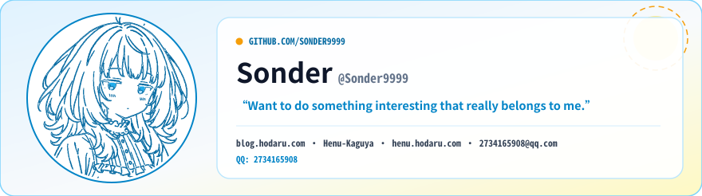
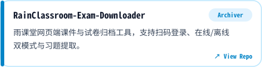
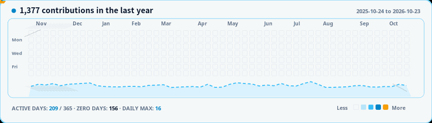

<a href="https://github.com/Sonder9999">
  <picture><source media="(prefers-color-scheme: dark)" srcset="assets/hero-night.svg" /><source media="(prefers-color-scheme: light)" srcset="assets/hero-day.svg" /></picture>
</a>

  <a href="https://blog.hodaru.com/"><picture><source media="(prefers-color-scheme: dark)" srcset="assets/nav-blog-night.svg" /><source media="(prefers-color-scheme: light)" srcset="assets/nav-blog-day.svg" /></picture></a>
  <a href="https://github.com/orgs/Henu-Kaguya/repositories"><picture><source media="(prefers-color-scheme: dark)" srcset="assets/nav-org-night.svg" /><source media="(prefers-color-scheme: light)" srcset="assets/nav-org-day.svg" /></picture></a>
  <a href="https://henu.hodaru.com/"><picture><source media="(prefers-color-scheme: dark)" srcset="assets/nav-website-night.svg" /><source media="(prefers-color-scheme: light)" srcset="assets/nav-website-day.svg" /></picture></a>
  <a href="mailto:2734165908@qq.com"><picture><source media="(prefers-color-scheme: dark)" srcset="assets/nav-email-night.svg" /><source media="(prefers-color-scheme: light)" srcset="assets/nav-email-day.svg" /></picture></a>
  <picture><source media="(prefers-color-scheme: dark)" srcset="assets/nav-qq-night.svg" /><source media="(prefers-color-scheme: light)" srcset="assets/nav-qq-day.svg" /></picture>

## Projects

  <a href="https://github.com/Sonder9999/kiko-dandan-downloader"><picture><source media="(prefers-color-scheme: dark)" srcset="assets/project-1-night.svg" /><source media="(prefers-color-scheme: light)" srcset="assets/project-1-day.svg" /></picture></a>
  <a href="https://github.com/Sonder9999/kiko-gamepad"><picture><source media="(prefers-color-scheme: dark)" srcset="assets/project-2-night.svg" /><source media="(prefers-color-scheme: light)" srcset="assets/project-2-day.svg" /></picture></a>

  <a href="https://github.com/chlchi/RainClassroom-Exam-Downloader"><picture><source media="(prefers-color-scheme: dark)" srcset="assets/project-3-night.svg" /><source media="(prefers-color-scheme: light)" srcset="assets/project-3-day.svg" /></picture></a>
  <a href="https://github.com/Sonder9999/better-petit-planet"><picture><source media="(prefers-color-scheme: dark)" srcset="assets/project-4-night.svg" /><source media="(prefers-color-scheme: light)" srcset="assets/project-4-day.svg" /></picture></a>

  <a href="https://github.com/Sonder9999/astro-course-hub"><picture><source media="(prefers-color-scheme: dark)" srcset="assets/project-5-night.svg" /><source media="(prefers-color-scheme: light)" srcset="assets/project-5-day.svg" /></picture></a>

## Open Source

  <a href="https://github.com/CuteLeaf/Firefly/pull/473"><picture><source media="(prefers-color-scheme: dark)" srcset="assets/pr-1-night.svg" /><source media="(prefers-color-scheme: light)" srcset="assets/pr-1-day.svg" /></picture></a>
  <a href="https://github.com/CuteLeaf/Firefly/pull/508"><picture><source media="(prefers-color-scheme: dark)" srcset="assets/pr-2-night.svg" /><source media="(prefers-color-scheme: light)" srcset="assets/pr-2-day.svg" /></picture></a>
  <a href="https://github.com/CuteLeaf/Firefly/pull/511"><picture><source media="(prefers-color-scheme: dark)" srcset="assets/pr-3-night.svg" /><source media="(prefers-color-scheme: light)" srcset="assets/pr-3-day.svg" /></picture></a>
  <a href="https://github.com/CuteLeaf/Firefly/pull/513"><picture><source media="(prefers-color-scheme: dark)" srcset="assets/pr-4-night.svg" /><source media="(prefers-color-scheme: light)" srcset="assets/pr-4-day.svg" /></picture></a>
  <a href="https://github.com/Zeshawn-z/ChangjiangRainClassroomAssistant/pull/7"><picture><source media="(prefers-color-scheme: dark)" srcset="assets/pr-5-night.svg" /><source media="(prefers-color-scheme: light)" srcset="assets/pr-5-day.svg" /></picture></a>

## Contributions

<!-- Theme 10: Day = comic fade-in, Night = original meteor shower -->

  <a href="https://github.com/Sonder9999">
    <picture><source media="(prefers-color-scheme: dark)" srcset="assets/contrib-night-anim.gif" /><source media="(prefers-color-scheme: light)" srcset="assets/contrib-anim.gif" /></picture>
  </a>

